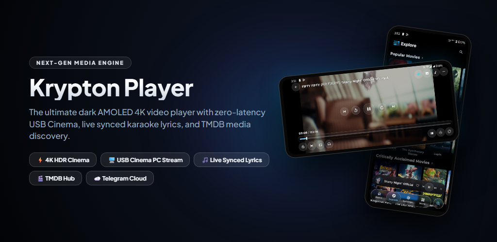
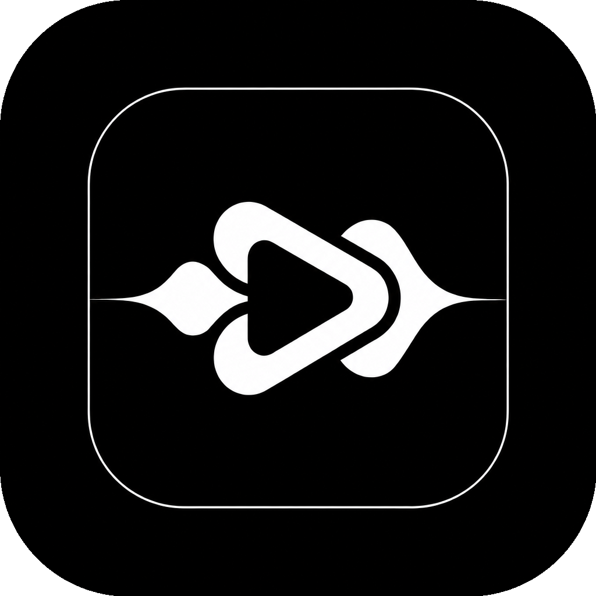
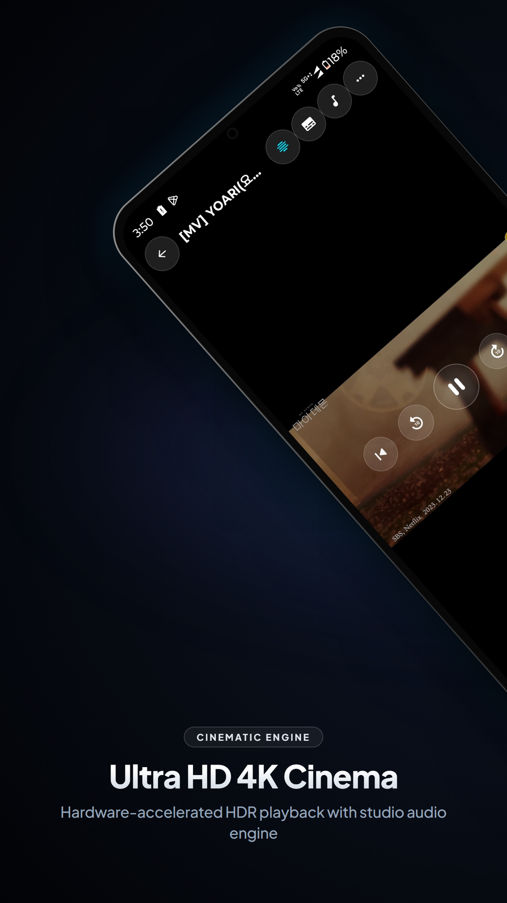
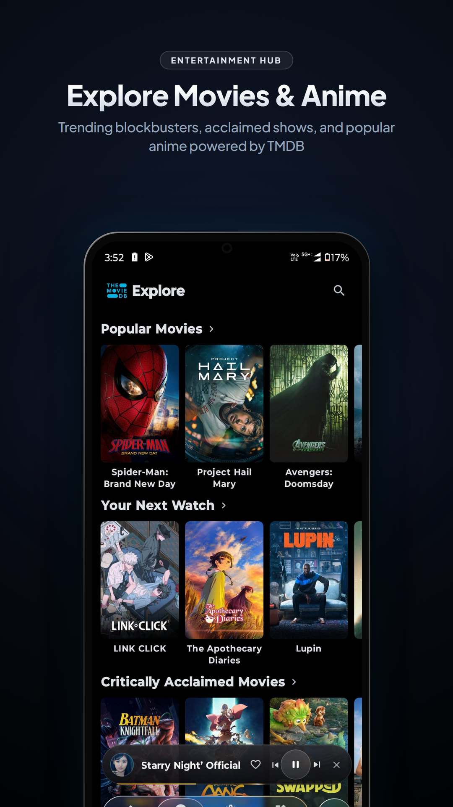
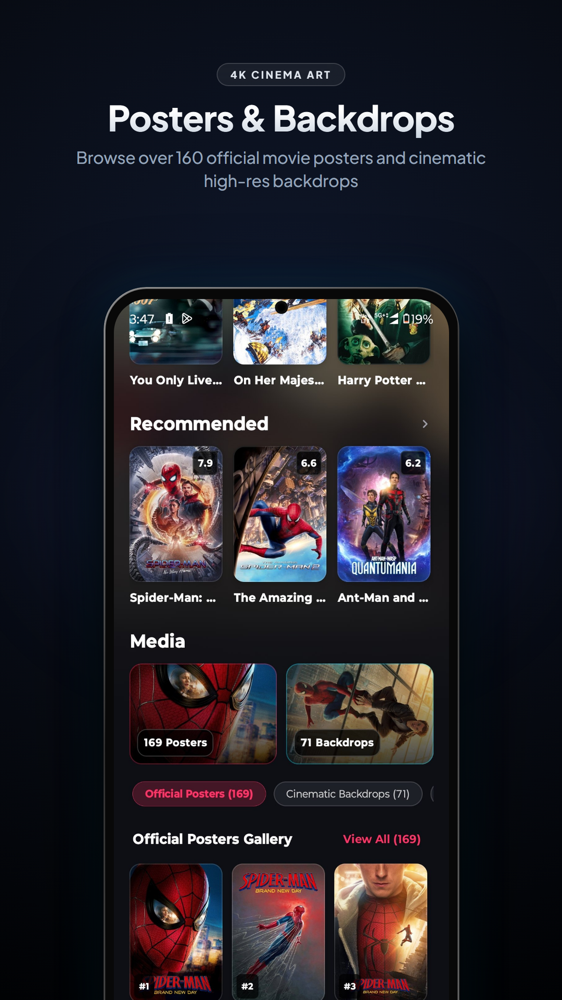
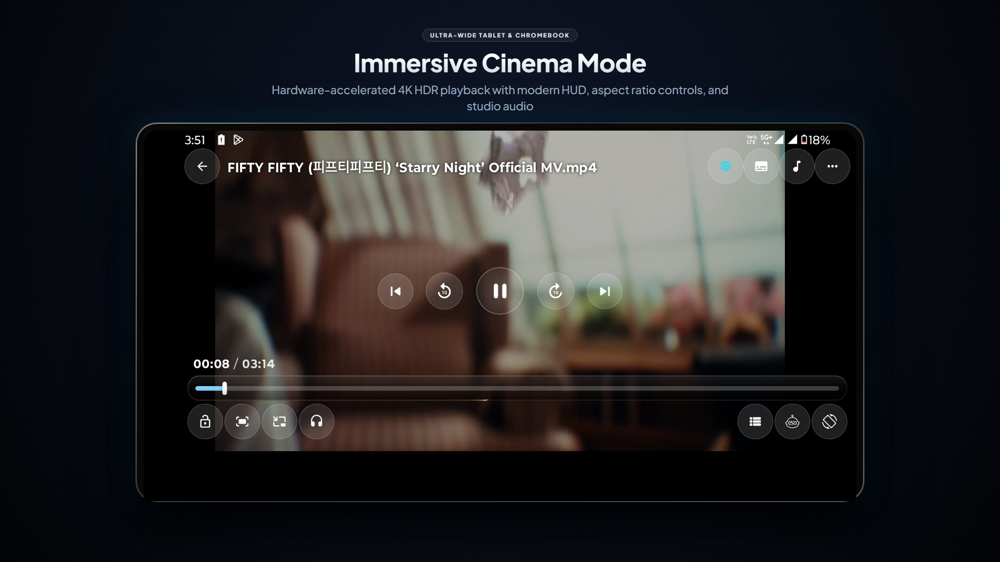

<!--
=================================================================
                     KRYPTON PLAYER
         The Ultimate Next-Gen Media Player for Android
=================================================================
GitHub     : https://github.com/RoxyBasicNeedBot/Krypton-Player
Telegram   : https://t.me/KryptonPlayer
Release    : v0.16.102 (ARM64-v8a / Universal)
License    : GNU General Public License v3.0
(C) 2026 RoxyBasicNeedBot. All Rights Reserved.
=================================================================
-->



<div align="center">

  <br />

  <a href="https://github.com/RoxyBasicNeedBot/Krypton-Player">
    
  </a>

  <h1>Krypton Player</h1>

  <sub>What is Krypton Player? its a sleek modern ultra-fast 4K HDR media player for android, open source, packed with features and doesn’t collect ur data >_< !! oh and, still in beta! so please expect some bug :)</sub>

  <br /><br />

  <p align="center">
    <a href="https://github.com/RoxyBasicNeedBot/Krypton-Player" target="_blank" rel="noopener noreferrer">
      
    </a>
  </p>

  <p align="center">
    <a href="https://github.com/RoxyBasicNeedBot/Krypton-Player/releases">
      
    </a>
    <a href="https://github.com/RoxyBasicNeedBot/Krypton-Player/stargazers">
      
    </a>
    <a href="https://github.com/RoxyBasicNeedBot/Krypton-Player/network/members">
      
    </a>
    <a href="https://github.com/RoxyBasicNeedBot/Krypton-Player/releases">
      
    </a>
    <br />
    <a href="https://github.com/RoxyBasicNeedBot/Krypton-Player/releases/latest">
      
    </a>
    <a href="https://t.me/KryptonPlayer">
      
    </a>
    <a href="https://github.com/RoxyBasicNeedBot/Krypton-Player/blob/main/LICENSE">
      
    </a>
  </p>

  <p align="center">
    <a href="#overview"><b>Overview</b></a> &bull;
    <a href="#screenshots--showcase"><b>Screenshots</b></a> &bull;
    <a href="#core-capabilities"><b>Features</b></a> &bull;
    <a href="#live-synced-lyrics"><b>Synced Lyrics</b></a> &bull;
    <a href="#technical-specifications"><b>Tech Specs</b></a> &bull;
    <a href="#hhhh-how-to-install-3"><b>Installation</b></a> &bull;
    <a href="#credits--acknowledgments"><b>Credits</b></a> &bull;
    <a href="#community--support"><b>Community</b></a>
  </p>

</div>

<br />

> [!WARNING]
> This app is still in active beta! Expect some quirks & bugs. Reporting issues helps make Krypton Player even better!

---

## Hhhh-how to install? :3

1. On your phone, open the [latest release](https://github.com/RoxyBasicNeedBot/Krypton-Player/releases).
2. Download the `.apk` that matches your phone. If you are not sure, pick **arm64**, that is almost every phone from the last 8 years. The **universal** one works everywhere but is slightly bigger.
3. Open the downloaded file. Android will ask you to allow installs from your browser or file manager, say yes (you can turn it off again after).
4. Open **Krypton Player**. You are done, no account or login needed to start watching.

Updating works the same way: install the new apk over the old one and your library and settings stay intact.

> [!TIP]
> Only download Krypton Player from the releases page of this official repository or our official Telegram support group [@KryptonPlayer](https://t.me/KryptonPlayer). Avoid untrusted third-party re-uploads.

> [!BTW]
> We support Android 8.0+ officially.

<br />

<div align="center">
  
</div>

<br />

##  Overview

**Krypton Player** is a high-performance, dark AMOLED-optimized multimedia player designed for modern Android devices. Built on top of a customized hardware-accelerated playback pipeline (**ExoPlayer + FFmpeg Media3 engine**), Krypton Player seamlessly bridges high-definition local file playback, cloud streaming, and PC desktop integration into one unified, cinema-grade experience.

Unlike conventional media players, Krypton Player introduces groundbreaking capabilities:
- **Hardware-Accelerated 4K HDR**: Ultra-smooth 10-bit HEVC, AV1, and VP9 playback with native color mapping.
- **Floating Synced Karaoke Lyrics**: Sing along to music videos with synchronized, glowing word-by-word karaoke lyrics tracked in real time.
- **Deep TMDB Discovery**: Explore trending blockbusters, popular anime, and series with trailers, actor filmographies, and high-resolution poster archives.
- **Telegram Cloud Cinema**: Stream movies, anime episodes, and video files stored across Telegram channels and chats directly with zero local device storage consumption.

<br />

<div align="center">
  
</div>

<br />

##  Screenshots & Showcase

### Continuous Panoramic Split View (Slides 01 & 02)
*A continuous, uninterrupted 4K playback presentation designed for seamless Play Store carousel transitions.*

<div align="center">
  <table border="0" cellspacing="0" cellpadding="0">
    <tr>
      <td width="50%" align="center">
        
      </td>
      <td width="50%" align="center">
        
      </td>
    </tr>
  </table>
</div>

<br />

### Core Feature Showcase (Slides 03 to 10)

<div align="center">
  <table border="0" cellspacing="8" cellpadding="0">
    <tr>
      <td width="25%" align="center" valign="top">
        <br />
        <sub><b>Floating Synced Lyrics</b><br />Real-time karaoke pacing</sub>
      </td>
      <td width="25%" align="center" valign="top">
        <br />
        <sub><b>Wired USB Cinema</b><br />Zero-latency 4K PC stream</sub>
      </td>
      <td width="25%" align="center" valign="top">
        <br />
        <sub><b>Swipe & Turbo Speed</b><br />Vertical brightness HUD</sub>
      </td>
      <td width="25%" align="center" valign="top">
        <br />
        <sub><b>Explore Movies & Anime</b><br />Powered by TMDB</sub>
      </td>
    </tr>
    <tr>
      <td width="25%" align="center" valign="top">
        <br />
        <sub><b>Movie & Cast Details</b><br />Trailers, IMDb 8.5 & bios</sub>
      </td>
      <td width="25%" align="center" valign="top">
        <br />
        <sub><b>Telegram Cloud Player</b><br />Direct cloud streaming</sub>
      </td>
      <td width="25%" align="center" valign="top">
        <br />
        <sub><b>Creative Power Tools</b><br />X-Ray, Shazam & Clip Maker</sub>
      </td>
      <td width="25%" align="center" valign="top">
        <br />
        <sub><b>Posters & Backdrops</b><br />160+ official movie art</sub>
      </td>
    </tr>
  </table>
</div>

<br />

### Ultra-Wide Tablet Cinema Mode (1920 &times; 1080)
*Tailored for tablets, foldables, and Chromebooks with wide-aspect playback controls.*

<div align="center">
  
</div>

<br />

<div align="center">
  
</div>

<br />

##  Core Capabilities

<div align="center">
<table width="100%">
  <tr>
    <td width="50%" valign="top">
      <div align="left">
        <h3> Cinema-Grade Playback</h3>
        <ul>
          <li><b>Hardware-Accelerated Decoders</b>: 10-bit HEVC/H.265, AV1, VP9, H.264, and ProRes support.</li>
          <li><b>High Dynamic Range (HDR)</b>: HDR10, HDR10+, HLG, and Dolby Vision profile passthrough.</li>
          <li><b>Multichannel Audio Matrix</b>: Bitstream passthrough for Dolby Atmos, TrueHD, DTS-HD MA, and multichannel AAC.</li>
          <li><b>Universal Container Compatibility</b>: MKV, MP4, WebM, AVI, TS, M2TS, ISO, and MOV playback.</li>
          <li><b>Frame-Perfect Seeking</b>: Precision scrub bar with exact millisecond keyframe accuracy.</li>
        </ul>
      </div>
    </td>
    <td width="50%" valign="top">
      <div align="left">
        <h3> Precision Gestures</h3>
        <ul>
          <li><b>Dual Vertical Swipe HUD</b>: Smooth brightness adjustment on the left, volume slider on the right.</li>
          <li><b>Double-Tap Seek</b>: Configurable jump interval (5s, 10s, 15s, 30s) on left/right edges.</li>
          <li><b>Press & Hold 2.0x Boost</b>: Temporary 2.00x playback speed acceleration while holding the display.</li>
          <li><b>Pinch-to-Zoom Aspect Control</b>: Fit, fill, stretch, 16:9, 21:9, and custom cinema crop modes.</li>
        </ul>
      </div>
    </td>
  </tr>
  <tr>
    <td width="50%" valign="top">
      <div align="left">
        <h3> Floating Synced Lyrics</h3>
        <ul>
          <li><b>Real-Time Karaoke Highlighting</b>: Word-by-word active line tracking with animated glow.</li>
          <li><b>Floating Picture-in-Picture Modal</b>: Non-intrusive floating dialog over widescreen video.</li>
          <li><b>Universal Lyrics Providers</b>: Aggregated lyrics fetching from LRCLIB, Spotify, and local LRC files.</li>
          <li><b>Manual Timestamp Offset</b>: Adjustable sync slider for audio-to-lyric synchronization tuning.</li>
        </ul>
      </div>
    </td>
    <td width="50%" valign="top">
      <div align="left">
        <h3> TMDB Entertainment Hub</h3>
        <ul>
          <li><b>Trending & Popular</b>: Real-time movie charts, seasonal anime, and trending TV shows.</li>
          <li><b>Cinematic Metadata</b>: IMDb/TMDB rating badges, MPAA ratings, runtime, and overview synopsis.</li>
          <li><b>Official Trailers</b>: In-app trailer playback powered by YouTube / HLS streaming.</li>
          <li><b>Cast & Crew Biographies</b>: Full actor profiles, birth facts, filmography credits, and image galleries.</li>
        </ul>
      </div>
    </td>
  </tr>
  <tr>
    <td width="50%" valign="top">
      <div align="left">
        <h3> Telegram Cloud Streamer</h3>
        <ul>
          <li><b>Direct Cloud Playback</b>: Stream large media files directly from Telegram chats without pre-downloading.</li>
          <li><b>Reels Mode</b>: Continuous vertical video playback tailored for channel short clips.</li>
          <li><b>Integrated Download Manager</b>: High-speed background downloader with live ETA and speed graph.</li>
          <li><b>Channel Media Library</b>: Bookmarking, favorites, and watch later queues.</li>
        </ul>
      </div>
    </td>
    <td width="50%" valign="top">
      <div align="left">
        <h3> Creative Power Tools</h3>
        <ul>
          <li><b>Amazon X-Ray Inspection</b>: On-screen actor, character, and trivia information during scenes.</li>
          <li><b>Shazam Audio Identifier</b>: Identify background soundtracks with 30-second previews.</li>
          <li><b>Lossless Video Clip Maker</b>: Trim and export video segments without re-encoding.</li>
          <li><b>Ringtone Extractor</b>: Cut audio segments and export directly as high-bitrate MP3 ringtones.</li>
        </ul>
      </div>
    </td>
  </tr>
  <tr>
    <td width="50%" valign="top">
      <div align="left">
        <h3> Cinema Art & Backdrops</h3>
        <ul>
          <li><b>Poster Archive</b>: Browse over 160 official high-resolution movie posters per title.</li>
          <li><b>Cinematic Backdrops</b>: 70+ widescreen cinematic backdrops ready for wallpaper export.</li>
          <li><b>Smart Media Library</b>: Automatic folder clustering, format tags (FHD / 4K), and multi-criteria sorting.</li>
          <li><b>Playlist Queue Manager</b>: Drag-and-drop queue reordering with seamless track transitions.</li>
        </ul>
      </div>
    </td>
    <td width="50%" valign="top">
      <div align="left">
        <h3> Local & Network Playback</h3>
        <ul>
          <li><b>SMB & WebDAV Client</b>: Stream from local NAS, PCs, and home network shares.</li>
          <li><b>Picture-in-Picture (PiP)</b>: Continue watching in a floating window while multitasking.</li>
          <li><b>Background Audio Playback</b>: Listen to video podcasts and concerts with screen locked.</li>
          <li><b>Audio Track & Subtitle Switcher</b>: Multi-track selection with subtitle sync delay calibration.</li>
        </ul>
      </div>
    </td>
  </tr>
</table>
</div>

<br />

<div align="center">
  
</div>

<br />

##  Floating Synced Lyrics Engine

Krypton Player includes a built-in synchronized lyrics parser supporting LRC, enhanced LRC with millisecond timestamps, and cloud-synced lyric engines.

```
+-------------------------------------------------------------------+
|  [01:23.45] Never gonna give you up                                |
|  [01:25.10] Never gonna let you down                                |
| >[01:27.80] Never gonna run around and desert you < (Active Glow)  |
|  [01:31.20] Never gonna make you cry                                |
+-------------------------------------------------------------------+
```

- **Pacing Visualizer**: The active line highlights smoothly with font-weight scaling and dynamic AMOLED glow.
- **Tap-to-Seek**: Tap any lyric line in the window to instantly jump video playback to that exact timestamp.
- **Offset Calibration**: Easily adjust subtitle timing offsets (+/- 100ms steps) to fix poorly synced files.

<br />

<div align="center">
  
</div>

<br />

##  Technical Specifications

<div align="center">
<table width="100%">
  <thead>
    <tr bgcolor="#0f172a">
      <th align="left">Component</th>
      <th align="left">Specification / Standard</th>
    </tr>
  </thead>
  <tbody>
    <tr>
      <td><b>Min Android Target</b></td>
      <td>Android 8.0 Oreo (API Level 26)</td>
    </tr>
    <tr>
      <td><b>Target SDK</b></td>
      <td>Android 14 (API Level 34) / Android 15 Ready</td>
    </tr>
    <tr>
      <td><b>ABIs Supported</b></td>
      <td><code>arm64-v8a</code>, <code>armeabi-v7a</code>, <code>x86_64</code></td>
    </tr>
    <tr>
      <td><b>Core Player Framework</b></td>
      <td>Google AndroidX Media3 / ExoPlayer Core v1.3.x</td>
    </tr>
    <tr>
      <td><b>Video Codecs</b></td>
      <td>HEVC (H.265 Main 10), AV1, VP9 Profile 2, AVC (H.264 High 4:2:2), VC-1, MPEG-2</td>
    </tr>
    <tr>
      <td><b>Audio Codecs</b></td>
      <td>Dolby TrueHD, Dolby Atmos, DTS-HD Master Audio, FLAC, ALAC, Opus, AAC-LC, AC-3, E-AC-3</td>
    </tr>
    <tr>
      <td><b>Subtitles</b></td>
      <td>ASS/SSA (Advanced SubStation Alpha with custom styling), SubRip (.srt), VTT, PGS (BD-ROM)</td>
    </tr>
    <tr>
      <td><b>Design System</b></td>
      <td>Pure Material 3 (Material You) with Dark AMOLED Palette</td>
    </tr>
  </tbody>
</table>
</div>

<br />

<div align="center">
  
</div>

<br />

##  Community & Support

- **Official Community**: [Telegram @KryptonPlayer](https://t.me/KryptonPlayer)
- **Bug Reports**: Open an issue on [GitHub Issues](https://github.com/RoxyBasicNeedBot/Krypton-Player/issues)
- **Pull Requests**: Community contributions and optimizations are welcome!

<br />

<div align="center">
  
</div>

<br />

##  Credits & Acknowledgments

Krypton Player stands proudly on the shoulders of the open-source community. Sincerest gratitude and recognition to:
- **[Next Player](https://github.com/anilbeesetti/nextplayer)** by **[Anil Beesetti](https://github.com/anilbeesetti)** — The foundational open-source Android video player upon which Krypton Player is built. Deep gratitude to Anil Beesetti and all upstream contributors for the solid Kotlin architecture and player core.
- **[mpv-android](https://github.com/mpv-android/mpv-android)** & **[mpvKt](https://github.com/anilbeesetti/mpvKt)** — High-performance native media decoding engine and Kotlin bindings.
- **[Google ExoPlayer / AndroidX Media3](https://github.com/androidx/media)** — Android's reference media streaming and playback framework.
- **[FFmpeg](https://ffmpeg.org/)** — Industry standard multimedia decoding and demuxing libraries.

<br />

<div align="center">
  
</div>

<br />

##  License

Krypton Player is open-source software licensed under the **GNU General Public License v3.0 (GPLv3)**.

```
Copyright (C) 2026 RoxyBasicNeedBot

This program is free software: you can redistribute it and/or modify
it under the terms of the GNU General Public License as published by
the Free Software Foundation, either version 3 of the License, or
(at your option) any later version.
```

---

<div align="center">
  <sub>Engineered by <b>RoxyBasicNeedBot</b> &bull; Built for true cinema enthusiasts.</sub>
</div>
