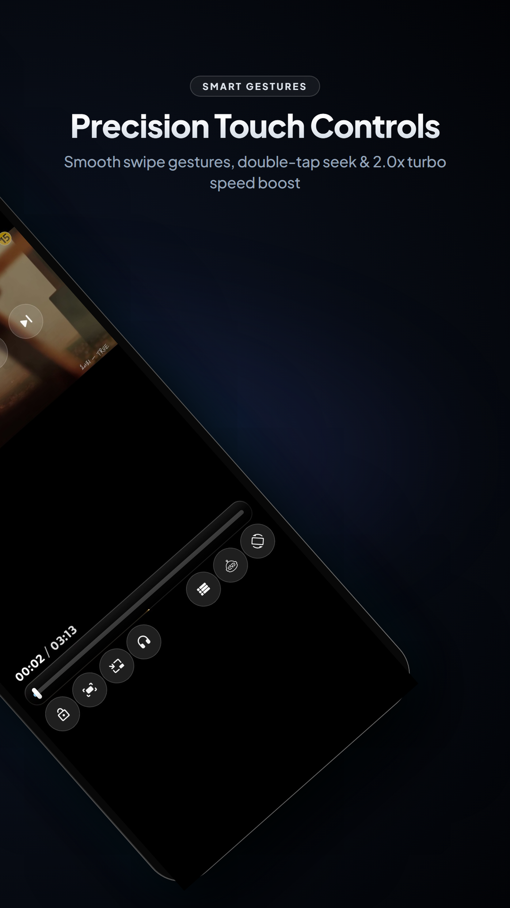
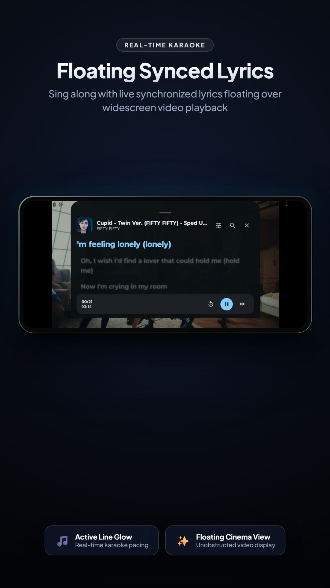
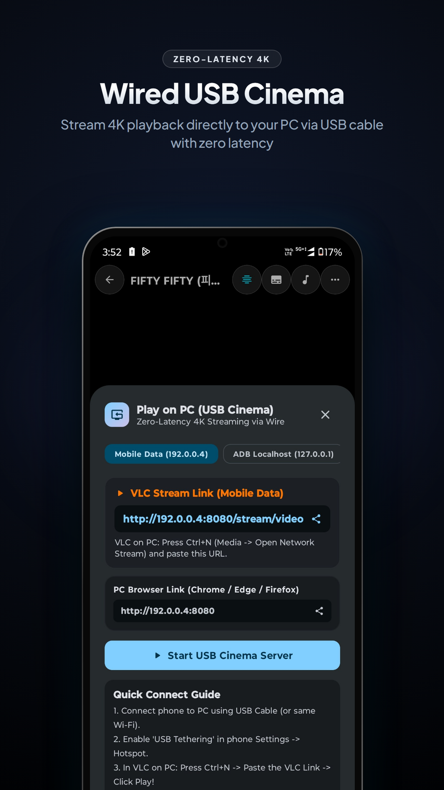
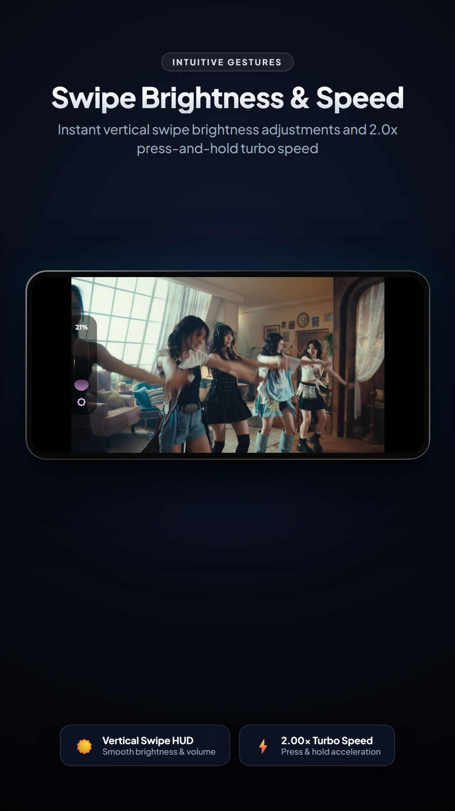
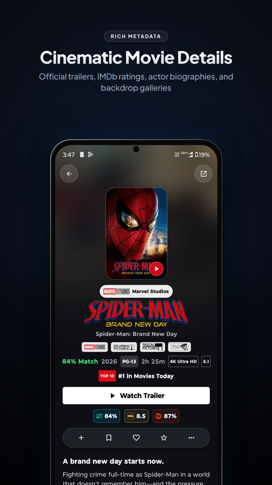
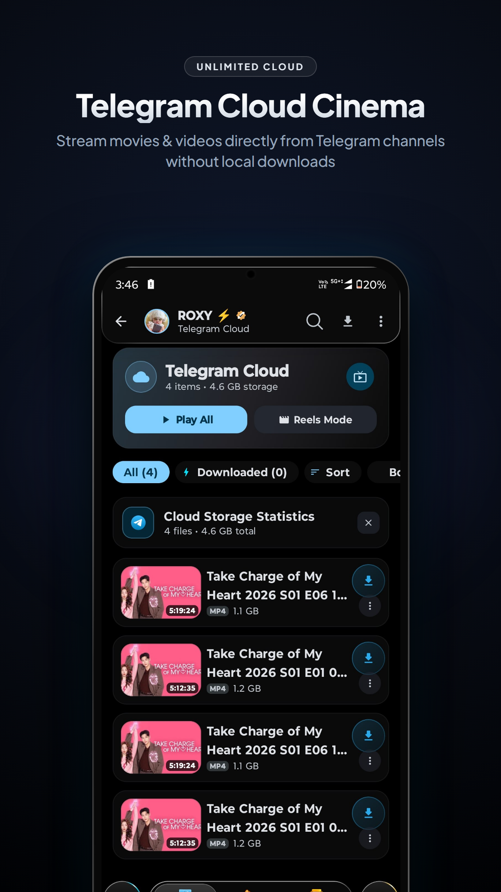
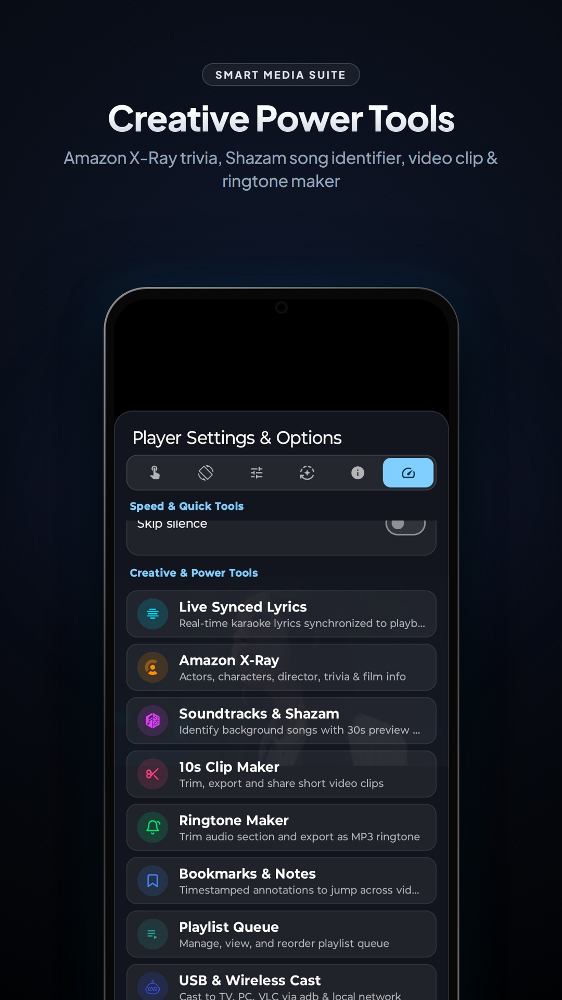

<!--
=================================================================
                     KRYPTON PLAYER
         The Ultimate AMOLED 4K HDR Media Player for Android
=================================================================
GitHub     : https://github.com/RoxyBasicNeedBot/Krypton-Player
Telegram   : https://t.me/KryptonPlayer
License    : GNU Affero General Public License v3.0
(C) 2026 RoxyBasicNeedBot. All Rights Reserved.
=================================================================
-->

<div align="center">

  <a href="https://github.com/RoxyBasicNeedBot/Krypton-Player">
    
  </a>

  <br /><br />

  <a href="https://github.com/RoxyBasicNeedBot/Krypton-Player">
    
  </a>

  <h1>Krypton Player</h1>

  <p>
    <b>Pure AMOLED 4K HDR Cinema Player for Android</b><br />
    <sub>Open-Source &bull; Zero Ads &bull; Zero Tracking &bull; libmpv + FFmpeg &bull; Floating Synced Lyrics &bull; Telegram Cloud Cinema &bull; TMDB Discovery</sub>
  </p>

  <p align="center">
    <a href="https://github.com/RoxyBasicNeedBot/Krypton-Player/releases/latest">
      
    </a>
    <a href="https://github.com/RoxyBasicNeedBot/Krypton-Player/releases">
      
    </a>
    <a href="https://github.com/RoxyBasicNeedBot/Krypton-Player/stargazers">
      
    </a>
    <a href="https://github.com/RoxyBasicNeedBot/Krypton-Player/network/members">
      
    </a>
  </p>

  <p align="center">
    <a href="https://github.com/RoxyBasicNeedBot/Krypton-Player/actions/workflows/android_build.yaml">
      
    </a>
    <a href="https://github.com/RoxyBasicNeedBot/Krypton-Player/commits/main">
      
    </a>
    <a href="https://github.com/RoxyBasicNeedBot/Krypton-Player/issues">
      
    </a>
    <a href="https://github.com/RoxyBasicNeedBot/Krypton-Player/releases">
      
    </a>
    <a href="https://t.me/KryptonPlayer">
      
    </a>
    <a href="https://github.com/RoxyBasicNeedBot/Krypton-Player/blob/main/LICENSE">
      
    </a>
  </p>

  <br />

  <p align="center">
    <a href="#stats"><b>Live Stats</b></a> &bull;
    <a href="#download"><b>Download</b></a> &bull;
    <a href="#screenshots"><b>Screenshots</b></a> &bull;
    <a href="#features"><b>Features</b></a> &bull;
    <a href="#lyrics"><b>Synced Lyrics</b></a> &bull;
    <a href="#tech-specs"><b>Tech Specs</b></a> &bull;
    <a href="#contributors"><b>Contributors</b></a> &bull;
    <a href="#community"><b>Community</b></a>
  </p>

</div>

<br />

> [!WARNING]
> **Active Beta Notice:** Krypton Player is under active development. If you spot a bug or want a feature, please open an issue on [GitHub Issues](https://github.com/RoxyBasicNeedBot/Krypton-Player/issues) or ping us in [@KryptonPlayer](https://t.me/KryptonPlayer).

---

<a id="stats"></a>

## 📊 Live Repository Pulse

<!-- BOT:STATS:START -->
<div align="center">

| ⭐ Stars | 🍴 Forks | 📥 Total Downloads | 👀 Watchers | 🏷️ Latest Release | 🐛 Open Issues |
| :---: | :---: | :---: | :---: | :---: | :---: |
| **11** | **8** | **61** | **4** | **[v0.16.31](https://github.com/RoxyBasicNeedBot/Krypton-Player/releases/tag/v0.16.31)** | **[0](https://github.com/RoxyBasicNeedBot/Krypton-Player/issues)** |

<p>
  <b>🏆 Next Star Milestone:</b> `█████████░░░░░░░░░░░` **44%** (11 / 25 ⭐)
</p>

<sub>🤖 <i>Auto-synced by <b>Krypton README Bot</b> &bull; Last updated: Nov 28, 2026 • 09:22 UTC</i></sub>

</div>
<!-- BOT:STATS:END -->

<br />

<div align="center">
  
</div>

<br />

<a id="download"></a>

## 📥 Download & Installation

<!-- BOT:LATEST_RELEASE:START -->
### 🚀 Latest Release: [KryptonPlayer v0.16.31](https://github.com/RoxyBasicNeedBot/Krypton-Player/releases/tag/v0.16.31) — `Nov 28, 2026`

| Architecture / Variant | Size | Downloads | Direct Download |
| :--- | :---: | :---: | :---: |
| **ARM64-v8a** *(Recommended)* | `59.2 MB` | 0 | [**⬇ Download APK**](https://github.com/RoxyBasicNeedBot/Krypton-Player/releases/download/v0.16.31/app-arm64-v8a-release.apk) |
| **ARMv7** *(32-bit)* | `55.8 MB` | 0 | [**⬇ Download APK**](https://github.com/RoxyBasicNeedBot/Krypton-Player/releases/download/v0.16.31/app-armeabi-v7a-release.apk) |
| **Universal** *(All Devices)* | `148.5 MB` | 0 | [**⬇ Download APK**](https://github.com/RoxyBasicNeedBot/Krypton-Player/releases/download/v0.16.31/app-universal-release.apk) |
<!-- BOT:LATEST_RELEASE:END -->

### Quick Install Steps
1. Open the [**Latest Release**](https://github.com/RoxyBasicNeedBot/Krypton-Player/releases/latest) page on your Android device.
2. Pick the APK for your device:
   - **`arm64-v8a`** *(Recommended)* — Smallest & fastest build for almost all Android phones from the last 8 years.
   - **`armeabi-v7a`** — For older 32-bit Android devices.
   - **`universal`** — Works on every Android architecture.
3. Open the downloaded `.apk` and grant *Install unknown apps* permission when prompted.
4. Launch **Krypton Player** — no mandatory login or account required.

> [!NOTE]
> **Official Android Support:** Android 8.0 Oreo (API 26) through Android 14 / 15 with full edge-to-edge navigation & AMOLED support.
> Only download APKs from this official repository or [@KryptonPlayer](https://t.me/KryptonPlayer).

<br />

<div align="center">
  
</div>

<br />

##  Overview

**Krypton Player** is a next-generation, **Pure Black AMOLED (`#000000`)** multimedia player crafted in Kotlin & Jetpack Compose. Powered by **AndroidX Media3 (ExoPlayer) + FFmpeg**, it combines ultra-smooth local 4K HDR playback, a real-time floating synced karaoke lyrics engine, deep TMDB discovery, and direct Telegram Cloud streaming inside a fluid, obsidian-glass Mochi-inspired interface.

- **True Pure Black AMOLED Obsidian UI** — Zero gray washout, live GPU-blurred floating navigation dock, scroll-reactive frosted headers, and clean monochrome cinema controls.
- **Hardware-Accelerated 4K HDR** — 10-bit HEVC, AV1, VP9, HDR10/HDR10+/Dolby Vision passthrough with frame-accurate seeking.
- **Floating Synced Karaoke Lyrics** — Real-time word/line highlighting with tap-to-seek and manual millisecond sync calibration.
- **TMDB Discovery Hub** — Explore trending movies, seasonal anime, and series with ratings, trailers, cast bios, and HD poster galleries.
- **Telegram Cloud Cinema** — Stream movies, series, and Reels directly from Telegram channels without filling device storage.

<br />

<div align="center">
  
</div>

<br />

<a id="screenshots"></a>

##  Screenshots & Showcase

### Panoramic 4K Playback & Precision Controls

<div align="center">
  <table border="0" cellspacing="0" cellpadding="0">
    <tr>
      <td width="50%" align="center">
        
      </td>
      <td width="50%" align="center">
        
      </td>
    </tr>
  </table>
</div>

<br />

### Feature Highlights

<div align="center">
  <table border="0" cellspacing="8" cellpadding="0">
    <tr>
      <td width="25%" align="center" valign="top">
        <br />
        <sub><b>Floating Synced Lyrics</b><br />Real-time karaoke pacing</sub>
      </td>
      <td width="25%" align="center" valign="top">
        <br />
        <sub><b>Wired USB Cinema</b><br />Zero-latency 4K PC stream</sub>
      </td>
      <td width="25%" align="center" valign="top">
        <br />
        <sub><b>Swipe & Turbo Speed</b><br />Vertical brightness & volume</sub>
      </td>
      <td width="25%" align="center" valign="top">
        <br />
        <sub><b>Explore Movies & Anime</b><br />Powered by TMDB</sub>
      </td>
    </tr>
    <tr>
      <td width="25%" align="center" valign="top">
        <br />
        <sub><b>Movie & Cast Details</b><br />Trailers, ratings & bios</sub>
      </td>
      <td width="25%" align="center" valign="top">
        <br />
        <sub><b>Telegram Cloud Player</b><br />Direct cloud streaming</sub>
      </td>
      <td width="25%" align="center" valign="top">
        <br />
        <sub><b>Creative Power Tools</b><br />X-Ray, Shazam & Clip Maker</sub>
      </td>
      <td width="25%" align="center" valign="top">
        <br />
        <sub><b>Posters & Backdrops</b><br />160+ official movie art</sub>
      </td>
    </tr>
  </table>
</div>

<br />

<details>
  <summary><b>🖥️ View Ultra-Wide Tablet & Landscape Cinema Mode (1920 &times; 1080)</b></summary>
  <br />
  <div align="center">
    
  </div>
</details>

<br />

<div align="center">
  
</div>

<br />

<a id="features"></a>

##  Core Capabilities

<div align="center">
<table width="100%">
  <tr>
    <td width="50%" valign="top">
      <div align="left">
        <h3> Cinema-Grade Playback</h3>
        <ul>
          <li><b>Hardware Decoders</b>: 10-bit HEVC/H.265, AV1, VP9, H.264, and ProRes support.</li>
          <li><b>HDR Support</b>: HDR10, HDR10+, HLG, and Dolby Vision profile passthrough.</li>
          <li><b>Multichannel Audio</b>: Dolby Atmos, TrueHD, DTS-HD MA, FLAC, Opus & AAC.</li>
          <li><b>Universal Containers</b>: MKV, MP4, WebM, AVI, TS, M2TS, ISO, and MOV.</li>
          <li><b>Minimalist Cinema Seekbar</b>: Spring-animated monochrome scrubber with thumbnail previews.</li>
        </ul>
      </div>
    </td>
    <td width="50%" valign="top">
      <div align="left">
        <h3> Precision Gestures & AMOLED UI</h3>
        <ul>
          <li><b>Pure Black AMOLED</b>: Obsidian surfaces, live GPU blur dock, and frosted scroll headers.</li>
          <li><b>Dual Vertical Swipe HUD</b>: Clean obsidian brightness (left) & volume (right) indicators.</li>
          <li><b>Double-Tap Seek</b>: Configurable jump intervals (5s, 10s, 15s, 30s).</li>
          <li><b>Press & Hold 2.0x Boost</b>: Instant speed acceleration while holding the screen.</li>
          <li><b>Pinch-to-Zoom Aspect Control</b>: Fit, fill, stretch, 16:9, 21:9 & custom crop.</li>
        </ul>
      </div>
    </td>
  </tr>
  <tr>
    <td width="50%" valign="top">
      <div align="left">
        <h3> Floating Synced Lyrics</h3>
        <ul>
          <li><b>Real-Time Karaoke Glow</b>: Smooth active-line tracking & typography scaling.</li>
          <li><b>Floating Overlay Window</b>: Non-intrusive synced lyrics directly over widescreen playback.</li>
          <li><b>Multi-Provider Fetching</b>: LRCLIB, online lyric providers, and local <code>.lrc</code> files.</li>
          <li><b>Timestamp Calibration</b>: Fine-grained +/- 100ms manual offset slider.</li>
        </ul>
      </div>
    </td>
    <td width="50%" valign="top">
      <div align="left">
        <h3> TMDB Explore Hub</h3>
        <ul>
          <li><b>Trending & Popular</b>: Live movie charts, seasonal anime, and top TV series.</li>
          <li><b>Rich Metadata</b>: IMDb/TMDB badges, MPAA ratings, runtimes & synopses.</li>
          <li><b>In-App Trailers</b>: Seamless trailer playback inside the detail screen.</li>
          <li><b>Cast & Crew Profiles</b>: Full filmographies, biographies, and high-res poster archives.</li>
        </ul>
      </div>
    </td>
  </tr>
  <tr>
    <td width="50%" valign="top">
      <div align="left">
        <h3> Telegram Cloud Cinema</h3>
        <ul>
          <li><b>Zero-Storage Streaming</b>: Stream large movies & episodes straight from Telegram chats.</li>
          <li><b>Reels Mode</b>: Continuous vertical playback for channel short videos.</li>
          <li><b>Background Downloader</b>: Multi-threaded downloader with live speed & ETA.</li>
          <li><b>Watch Party & Cloud Library</b>: Synchronized playback, bookmarks & watch queues.</li>
        </ul>
      </div>
    </td>
    <td width="50%" valign="top">
      <div align="left">
        <h3> Power Tools & Network</h3>
        <ul>
          <li><b>X-Ray & Shazam Audio ID</b>: Identify actors, trivia, and background soundtracks live.</li>
          <li><b>Lossless Clip & Ringtone Maker</b>: Trim video clips or export MP3 ringtones cleanly.</li>
          <li><b>SMB & WebDAV Streaming</b>: Direct playback from NAS, PCs, and home network shares.</li>
          <li><b>PiP & Background Audio</b>: Floating Picture-in-Picture & screen-off audio playback.</li>
        </ul>
      </div>
    </td>
  </tr>
</table>
</div>

<br />

<div align="center">
  
</div>

<br />

<a id="lyrics"></a>

##  Floating Synced Lyrics Engine

Krypton Player features a custom synchronized lyrics engine supporting standard `.lrc`, enhanced millisecond-timed `.lrc`, and online cloud lyric sync:

```text
┌────────────────────────────────────────────────────────────────────┐
│  [01:23.45]  Never gonna give you up                               │
│  [01:25.10]  Never gonna let you down                              │
│ ▸[01:27.80]  Never gonna run around and desert you  ◂ Active Glow  │
│  [01:31.20]  Never gonna make you cry                              │
└────────────────────────────────────────────────────────────────────┘
```

- **Tap-to-Seek**: Tap any line in the lyrics panel to jump straight to that exact timestamp.
- **Offset Calibration**: Nudge sync timing in ±100ms steps for imperfect subtitle/lyric files.
- **AMOLED Friendly**: High-contrast typography designed to look razor-sharp over dark cinema scenes.

<br />

<div align="center">
  
</div>

<br />

<a id="tech-specs"></a>

##  Technical Specifications

| Component | Specification / Standard |
| :--- | :--- |
| **Minimum Android Version** | Android 8.0 Oreo (API Level 26) |
| **Target SDK** | Android 14 / Android 15 Ready (Edge-to-Edge) |
| **Supported ABIs** | `arm64-v8a`, `armeabi-v7a`, `universal` |
| **Core Playback Engine** | AndroidX Media3 / ExoPlayer + FFmpeg Decoder Extensions |
| **Video Codecs** | HEVC (H.265 Main 10), AV1, VP9 Profile 2, AVC/H.264, VC-1, MPEG-2 |
| **Audio Codecs** | Dolby TrueHD, Dolby Atmos, DTS-HD MA, FLAC, ALAC, Opus, AAC-LC, AC-3, E-AC-3 |
| **Subtitle Formats** | ASS/SSA (custom styling), SubRip (`.srt`), WebVTT (`.vtt`), PGS (BD-ROM) |
| **UI Architecture** | 100% Kotlin & Jetpack Compose • Material 3 • Pure Black AMOLED Obsidian System |

<br />

<div align="center">
  
</div>

<br />

## 📈 Star History & Recent Activity

<div align="center">
  <a href="https://star-history.com/#RoxyBasicNeedBot/Krypton-Player&Date">
    <picture>
      <source media="(prefers-color-scheme: dark)" srcset="https://api.star-history.com/svg?repos=RoxyBasicNeedBot/Krypton-Player&type=Date&theme=dark" />
      <source media="(prefers-color-scheme: light)" srcset="https://api.star-history.com/svg?repos=RoxyBasicNeedBot/Krypton-Player&type=Date" />
      
    </picture>
  </a>
</div>

<br />

<details>
  <summary><b>⚡ Latest Repository Commits (Auto-Updated by Bot)</b></summary>
  <br />
  <!-- BOT:ACTIVITY:START -->
| Commit | Message | Author | Date |
| :---: | :--- | :--- | :---: |
| [`a1761cc`](https://github.com/RoxyBasicNeedBot/Krypton-Player/commit/a1761cc471498208543d11fd229c4aad09726ba2) | docs(readme): auto-update live stats, releases & contributors [skip ci] | `@github-actions[bot]` | Nov 28, 2026 |
| [`5065ebf`](https://github.com/RoxyBasicNeedBot/Krypton-Player/commit/5065ebf5e53ae59aa9d74f62f5e6658d4817bbcf) | assets: add v0.16.31 release showcase banners (Mochy-style) | `@RoxyBasicNeedBot` | Nov 28, 2026 |
| [`a8dcf44`](https://github.com/RoxyBasicNeedBot/Krypton-Player/commit/a8dcf4479b469cd5cbcd591feea4a5c0fb7d166d) | docs(readme): auto-update live stats, releases & contributors [skip ci] | `@github-actions[bot]` | Nov 28, 2026 |
| [`73df46e`](https://github.com/RoxyBasicNeedBot/Krypton-Player/commit/73df46eb00c2625814e87769644f1f0cf0f7cad7) | feat(settings,stats,reporting): live in-app GitHub contributors, fixe... | `@RoxyBasicNeedBot` | Nov 28, 2026 |
| [`70ad204`](https://github.com/RoxyBasicNeedBot/Krypton-Player/commit/70ad204e24e94ed7ac344e3e21bba9d347cb1578) | docs(readme): auto-update live stats, releases & contributors [skip ci] | `@github-actions[bot]` | Nov 28, 2026 |
<!-- BOT:ACTIVITY:END -->
</details>

<br />

<div align="center">
  
</div>

<br />

<a id="contributors"></a>

##  Team & Contributors

### Lead Developer & Maintainer
- **ROXY** ([@RoxyBasicNeedBot](https://github.com/RoxyBasicNeedBot)) — Creator, Core Architecture, Mochi AMOLED UI & Cloud Cinema Integration.

### Community Contributors

<!-- BOT:CONTRIBUTORS:START -->
<div align="center">
<table>
  <tr>
    <td align="center" width="120"><a href="https://github.com/RoxyBasicNeedBot"><br /><sub><b>@RoxyBasicNeedBot</b></sub></a><br /><sub>19 commits</sub></td>
  </tr>
</table>
</div>
<!-- BOT:CONTRIBUTORS:END -->

### Open-Source Credits & Acknowledgments
Krypton Player stands on the shoulders of incredible open-source projects:
- **[Next Player](https://github.com/anilbeesetti/nextplayer)** by **[Anil Beesetti](https://github.com/anilbeesetti)** — The foundational Kotlin & Compose Android video player architecture.
- **[mpvRx](https://github.com/Riteshp2001/mpvRx)** & **[mpvlibAndroid](https://github.com/Riteshp2001/mpvlibAndroid)** — `libmpv` Android engine architecture, Vulkan/OpenGL pipeline, HDR/Anime4K shaders, and native bindings.
- **[mpv-android](https://github.com/mpv-android/mpv-android)** — Native `libmpv` Android build and Kotlin JNI layer.
- **[FFmpeg](https://ffmpeg.org/)** & **[libass](https://github.com/libass/libass)** — Industry-standard multimedia decoding, demuxing, and styled ASS/SSA subtitle rendering.

<br />

<div align="center">
  
</div>

<br />

<a id="community"></a>

##  Community & Support

<div align="center">

| Channel | Purpose | Link |
| :--- | :--- | :--- |
| **Telegram Group** | Support, previews, bot guides & community chat | [**Join @KryptonPlayer**](https://t.me/KryptonPlayer) |
| **Telegram Boost** | Boost the channel to unlock faster cloud perks | [**Boost @KryptonPlayer**](https://t.me/boost/KryptonPlayer) |
| **GitHub Issues** | Bug reports & feature requests | [**Open an Issue**](https://github.com/RoxyBasicNeedBot/Krypton-Player/issues) |
| **Pull Requests** | Code improvements, translations & fixes | [**Contribute a PR**](https://github.com/RoxyBasicNeedBot/Krypton-Player/pulls) |

</div>

<br />

##  License

Krypton Player is free and open-source software licensed under the **GNU Affero General Public License v3.0 ([AGPL-3.0](LICENSE))**.

```text
Copyright (C) 2026 RoxyBasicNeedBot

This program is free software: you can redistribute it and/or modify
it under the terms of the GNU Affero General Public License as published by
the Free Software Foundation, either version 3 of the License, or
(at your option) any later version.
```

---

<div align="center">
  <sub>If you enjoy <b>Krypton Player</b>, please consider leaving a ⭐ on GitHub!</sub><br />
  <sub>Engineered by <b>RoxyBasicNeedBot</b> &bull; Built for true AMOLED cinema enthusiasts.</sub>
</div>
